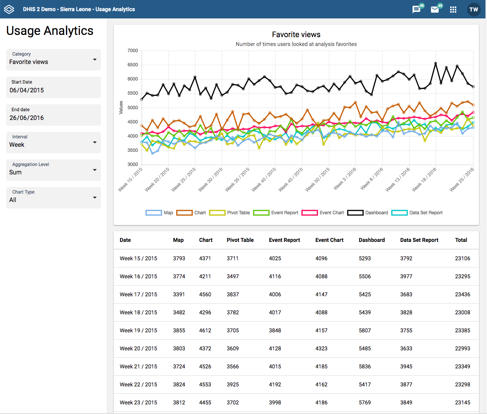

# Visualize usage statistics { #using_usage_analytics }

## About the Usage Analytics app

The **Usage Analytics** app lets you visualize statistics on how users work with dashboards, maps, visualizations, event reports, event charts, and data set reports in DHIS2. With these statistics you can answer questions such as:

-   How many times have people loaded visualizations and dashboards?

-   How many favorites have users created?

-   How many users log in, compared with the total number of users?

-   What are the most viewed favorites?

## Create a usage analytics graph { #usage_analytics_create_chart }

1.  Open the **Usage Analytics** app.

2.  Choose a **Category**.

    There are five analytics categories:

    -   **Favorite views**: Shows the number of times that users viewed different types of favorites, such as visualizations and dashboards, over time. Use **Aggregation Level** to show the sum (**Sum**) or the average (**Average**) number of views. Use **Chart Type** to show every type of favorite (**All**) or only the total (**Total**).

    -   **Favorites saved**: Shows the number of maps, visualizations, event reports, event charts, dashboards, and indicators that users created and saved in the system over time.

    -   **Users**: Shows the number of active users and the total number of users over time.

    -   **Top favorites**: Shows a list of favorites of one type, with the number of views for each. Use **Event Type** to choose the type: **Visualization**, **Map**, **Event report**, **Event chart**, **Dashboard**, or **Data set report**. Use **Page Size** to choose how many favorites to list (5, 10, 15, 20, or 25). Use **Sort Order** to list the most viewed favorites first (**Descending**) or the least viewed first (**Ascending**).

    -   **Data values**: Shows the number of data values saved in the system over time.

3.  Choose a **Start Date** and an **End Date**.

    The **Top favorites** category has no dates. Skip steps 3 and 4 for this category.

4.  Choose an **Interval**: **Day**, **Week**, **Month**, or **Year**.

    The app shows the graph for the category, dates, and interval that you chose.
